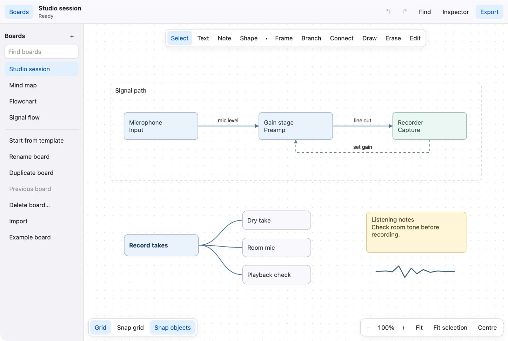

# Mind Mapper

Mind Mapper is a Mac canvas for mind maps, flow diagrams and sketches. It works offline and keeps your boards on your Mac.

I wanted a place where I could start with a few loose notes, work out how they connected, and turn part of the board into a figure for a document. A board can hold a branching plan, a signal flow and a quick drawing side by side.



*Mind Mapper 0.2.0 with a sample studio session board.*

## Working on a board

- **Start with an idea.** Place text, notes, shapes and frames anywhere on the canvas. Start from a mind map, flowchart or signal flow template, or open **Example board** to see the tools together.
- **Grow a mind map.** Add branches to either side, rearrange or fold a subtree, and paste an indented outline to make branches from existing writing.
- **Draw a flow.** Connect blocks at their ports, label the links and move the elbows. Use junctions for signal splits and align or lay out a group of blocks together.
- **Sketch around it.** Draw and erase freehand strokes alongside the diagram. Search the board for text, notes and connector labels.

## Export a figure

Choose **Export → Figure…** (⇧⌘E) to preview a whole board, a selection or a named frame. Adjust the padding and background, and choose whether to include folded branches.

| Format | Output |
| --- | --- |
| SVG | Scalable lines and shapes with live text |
| PDF | A single vector page sized to the figure |
| PNG | A raster image with optional transparency |
| JPEG | A raster image with a solid background |

**Export → Editable board** saves a `.mindmap` file you can reopen and edit. **Editable library** saves all your boards as a portable JSON backup. The Mac app stores your working library locally and keeps the previous saved revision for recovery.

## Build and try it

The current version is **0.2.0**. The Mac target is **macOS 14.5 or later**. The installed build has been checked on Apple silicon running macOS 27.2.1. Compatibility testing on macOS 14.5 and Intel is still open.

Use Xcode or Apple’s Command Line Tools to build the app from a clone.

```sh
git clone https://github.com/pat-crl/mindmapper.git
cd mindmapper
./prototype/mac/build.sh
open "builds/mindmapper/Mind Mapper.app"
```

This builds a locally signed app. For a quick look at the browser editor, open [`prototype/index.html`](prototype/index.html) in Chrome from the cloned folder. The browser has its own board library. Native PDF export and the Mac share sheet are available in the Mac app.

## Source and testing

The Mac shell uses Swift and AppKit. A bundled WebKit view runs the shared editor, and the same geometry drives the canvas and figure exports.

```sh
node --test prototype/tests/*.test.cjs
./prototype/mac/check.sh
```

The model tests use Node.js. The native check uses a scratch library and an app built with the command above. See the [Mac guide](prototype/README.md) for keyboard shortcuts, legacy imports and recovery, and the [0.2.0 audit](prototype/docs/installed-audit-0.2.0.md) for tested workflows and outstanding accessibility and compatibility work.

For bugs, start a [GitHub issue](https://github.com/pat-crl/mindmapper/issues/new) with your macOS version, Mind Mapper version and steps to reproduce. An example board is helpful for export or layout problems.

Created by Pat Carroll.
